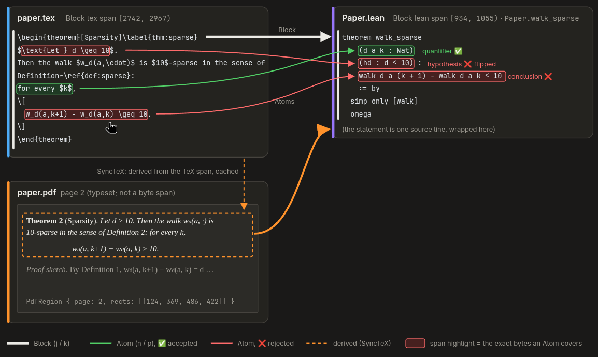

Back in September, [OpenAI released their solution](https://openai.com/index/navier-stokes-solution/) to the million dollar Millennium prize problem, a solution to the [Navier-Stokes equations](https://en.wikipedia.org/wiki/Navier%E2%80%93Stokes_equations) which blows up to $\infty$ in finite time. One month later, Bastounis et al released to the paper on [arXiv](https://arxiv.org/abs/2610.08144) called \"Navier-Stokes Lost in translation: Why Lean verification of AI autoformalisation does not guarantee correct natural language proofs\". This demonstrated that the Lean code that OpenAI generated might have type-checked, but it didn\'t correspond to the natural language proof in the PDF that was meant for humans to read. In other words, the formalization was not faithful.

$$\begin{aligned}
  \text{Paper (Lemma 8.6, eq. 8.19):}\quad
  &\bigl\|\mathcal{N}^{-1}F\bigr\|_{C^m_y}
    \le C_m\,\|F\|_{C^{\textcolor{#2F7FB5}{m+\mathbf{4}}}_y},
  &&\sum_{k\in\mathbb{Z}^2}\frac{1}{(1+|k|)^{\textcolor{#2F7FB5}{\mathbf{3}}}} < \infty \\[6pt]
  \text{Lean (\texttt{norm\_derivativeWord\_inverse\_le}):}\quad
  &\bigl\|\mathcal{N}^{-1}F\bigr\|_{C^m_y}
    \le K_m\,\|F\|_{C^{\textcolor{#C9442B}{m+\mathbf{5}}}_y},
  &&\sum_{k\in\mathbb{Z}^2}\frac{1}{(1+|k_1|+|k_2|)^{\textcolor{#C9442B}{\mathbf{4}}}} < \infty
\end{aligned}$$

The problem of converting a bunch of precise Lean code into a human-readable PDF is straightforward, this is like [literate programming](/writing/knuths-web-is-rewoven/). But the inverse is harder than the [Halting problem](https://en.wikipedia.org/wiki/Halting_problem).

> Solvability Complexity Index (SCI) hierarchy/arithmetical hierarchy (the SCI = ∞). Hence, informally, providing semantically faithful AI autoformalisation is harder than any computational problem including the Halting problem (which has SCI =1).
>
> [https://arxiv.org/abs/2610.08144](https://arxiv.org/abs/2610.08144)

The inverse process of going from natural language proof to formal language [Lean](https://lean-lang.org/') code automatically using AI is called autoformalization.

There is a backlog of mathematics from antiquity up through the present moment, the giants\' shoulders upon which we stand, which still needs to be formalized and imported so we can pick up where they left off. No matter how smart the models get, they will still need hyper-specialized human reviewers to review those first attempts at autoformalization. Their review will not be for correctness of the Lean code, that\'s something the Lean kernel itself checks. Their review will be for the faithfulness of the mapping between the $\LaTeX$ paper with natural language prose and the L∃∀N code that resulted from the autoformalization process.

I call this process the **faithfulness review**. The humans who do mathematics will use Lean\'s proof checker, but they will have to carefully review the faithfulness of the mapping between the paper and the Lean code.

An example of how this might work is a UI where the paper is on the left and the formal code is on the right. Each mapping is a first class object, and it can be annotated with the human\'s input. When all the mappings are audited, if it all checks out, then the Lean certificate and the Faithfulness Review certificate can be published. This creates a solid foundation to build upon for future mathematical work.

I am introducing a product that carries out this faithfulness review. If you are interested, subscribe to this newsletter to hear when it\'s ready. Until then,

> But prove all things; hold fast that which is good
>
> 1 Thessalonians 5:21
